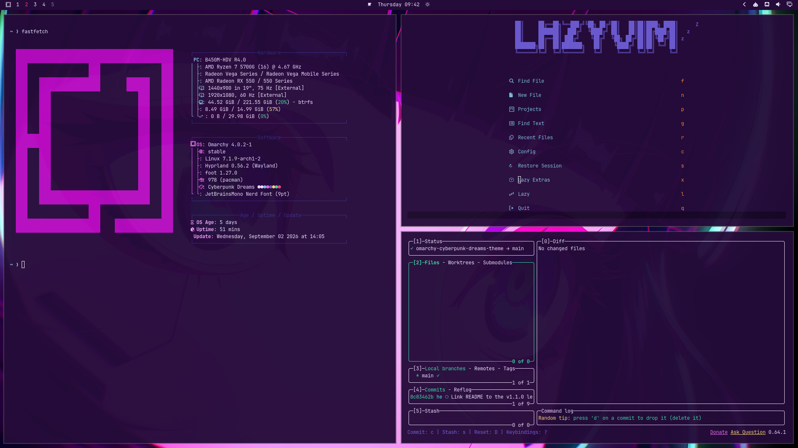

<div align="center">

# 🌃✨ Cyberpunk Dreams Theme ✨🌃


*A custom theme for Omarchy inspired by cyberpunk and anime aesthetics with neon purple, magenta, cyan, and pink colors.*

[🚀 Installation](#-installation) • [🎨 Color Palette](#-color-palette) • [📸 Preview](#-preview)

</div>

## 🎨 Color Palette

| Role | Preview | Hex Code |
|------|---------|----------|
| Background |  | `#240B39` |
| Accent (Magenta Neon) |  | `#B50BBF` |
| Cyan |  | `#7CC3E0` |
| Pink Light |  | `#F5A6F9` |
| Pink Neon (Magenta) |  | `#EB6BED` |
| Foreground |  | `#EBE2FB` |
| Selection |  | `#352B82` |
| Muted / Borders |  | `#2C17CA` |

The full ANSI palette (red, yellow, orange, green, blue, brown and their bright
variants) lives in [`colors.toml`](colors.toml) — that single file is the
source of truth for the whole theme.

## ✨ How it works

Since Omarchy moved to a `colors.toml`-driven theming system, this theme no
longer ships hand-written configs per application. Instead:

- [`colors.toml`](colors.toml) defines the full palette once.
- Omarchy generates Hyprland, Alacritty/Foot/Ghostty/Kitty, btop, Chromium,
  Neovim ([aether.nvim](https://github.com/bjarneo/aether.nvim)), and the
  Omarchy shell/bar styling from it automatically.
- [`shell.lock.toml`](shell.lock.toml) themes the lock screen.
- [`icons.theme`](icons.theme) sets the icon pack (`Yaru-magenta`).
- [`keyboard.rgb`](keyboard.rgb) sets RGB keyboard color on supported hardware.
- [`vscode.json`](vscode.json) points to a matching VS Code theme
  ([SynthWave '84](https://marketplace.visualstudio.com/items?itemName=robb0wen.synthwave84)).
- [`backgrounds/`](backgrounds) holds the theme's wallpapers.

If you're on an older Omarchy release that still uses per-app theme files,
check out a tag before `v2.0.0` of this repo.

## 🚀 Installation

### Via Omarchy Menu (Recommended)

1. Open Omarchy menu (`Super + Space`)
2. Go to **Install > Theme**
3. Enter the GitHub URL: `https://github.com/irythill/omarchy-cyberpunk-dreams-theme`
4. The theme will be automatically installed and available in the theme selector

### Manual Installation

```bash
git clone https://github.com/irythill/omarchy-cyberpunk-dreams-theme.git ~/.config/omarchy/themes/cyberpunk-dreams
omarchy theme set "cyberpunk-dreams"
```

## 📸 Preview



## 🔄 Rollback

```bash
omarchy theme set tokyo-night
```

## 🤝 Contributing

1. Fork the repository
2. Create a feature branch: `git checkout -b feature-name`
3. Edit `colors.toml` (and the optional files above) to make your changes
4. Run `omarchy theme set cyberpunk-dreams` to preview
5. Submit a pull request

## 📄 License

This theme is licensed under the **MIT License**. See the [LICENSE](LICENSE) file for details.

---

## 👥 Credits

<div align="center">

| Role | Contributor | Description |
|------|-------------|--------------|
| 👨‍💻 **Author** | deathko | Theme creator and maintainer |
| 🎨 **Inspiration** | Cyberpunk & Anime | Art styles and aesthetics |
| 🖼️ **Wallpaper** | [Sasha Yakovleva](https://www.youtube.com/watch?v=BnnbP7pCIvQ) | "Let You Down" - Cyberpunk: Edgerunners |

</div>
